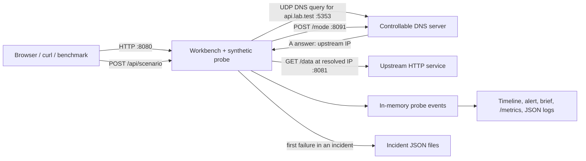

# DNS Failure Lab

A small service that **must resolve a DNS name before it can call an upstream HTTP service**. The lab deliberately breaks that resolution path, records what the probe actually saw, and turns the evidence into an alert, a diagnosis, and a draft incident brief for human review.

Everything measured here is **synthetic traffic generated by this lab**. It does not measure real users. The diagnosis is a deterministic set of rules over recorded evidence; there is no AI model or external LLM call.

## The short version

1. The workbench asks its custom resolver for the A record of `api.lab.test`.
2. The lab DNS server returns an IP address, delays, drops the reply, or returns an error according to the selected experiment.
3. The workbench tries `GET /data` at the **resolved IP**. It does not bypass DNS by calling the upstream container name.
4. One probe event records DNS and HTTP spans, durations, outcome, release metadata, and an evidence-derived diagnosis.
5. A failed probe raises the current alert. The first failure after a healthy period creates a persisted incident draft. A human can approve or reject it locally.
6. The benchmark changes scenarios, sends bounded parallel probes, saves observations separately from injected labels, then scores the diagnoses.

## Architecture



`compose.yaml` starts **three containers** from one Go binary using different `LAB_ROLE` values:

| Container | Role | Interface |
| --- | --- | --- |
| `upstream` | Serves `GET /data` and `GET /healthz` | TCP 8081 on the Compose network |
| `dns` | Answers UDP DNS queries; accepts internal fault controls | UDP 5353 and HTTP 8091 on the Compose network |
| `lab` | Runs probes, API, dashboard, alerting, diagnosis, and incident reviews | HTTP 8080, published only on `127.0.0.1` |

Compose waits for the upstream and DNS health checks before starting the workbench. The DNS process looks up the upstream container's IPv4 address through Docker's internal service discovery when it starts, then uses that address as the healthy A answer. The DNS and upstream ports are not published to the host.

`go run ./cmd/lab` is a simpler local mode: the same components run inside one process on loopback addresses. Use either this mode **or** Compose; both want port 8080.

## What happens during a healthy probe

```mermaid
sequenceDiagram
    participant P as Probe
    participant R as Custom Go resolver
    participant D as Lab DNS server
    participant U as Upstream HTTP service
    P->>R: LookupIPAddr("api.lab.test")
    R->>D: UDP DNS A / AAAA query
    D-->>R: A = upstream IPv4; AAAA = no records
    R-->>P: Resolved IP
    P->>U: TCP connect to resolved IP:8081, GET /data
    U-->>P: HTTP 200
    P->>P: Record spans, outcome, diagnosis, metrics
```

The probe uses Go's `net.Resolver` with `PreferGo: true` and a custom `Dial` function pointed at the lab DNS server. The DNS server parses the DNS question bytes and builds a DNS response packet. It returns an A record for `api.lab.test`, an empty answer for AAAA, and NXDOMAIN for other names.

After resolution, the probe uses a custom HTTP transport whose TCP dialer connects to the returned IP and upstream port. Keep-alives are disabled, so every probe exercises a new connection. That makes a bad DNS answer visible as an HTTP connection failure. The probe has an overall 700 ms context deadline; its TCP dial timeout is 400 ms and HTTP client timeout is 500 ms.

The workbench also runs one background probe every 5 seconds. `LAB_PROBE_INTERVAL` changes that interval.

## Fault injection: control plane versus observed data

`POST /api/scenario` is the **control plane**. It tells the workbench which synthetic experiment to apply. In Compose, the workbench sends `POST /mode` to the DNS container's internal admin port. Probe and state JSON are the **observation plane**: they omit the injected scenario label and report the DNS/HTTP behavior that was seen.

| Experiment | Injection | What a probe can observe |
| --- | --- | --- |
| `healthy` | DNS returns the upstream IPv4 address | DNS succeeds; HTTP returns 200 |
| `slow` | DNS waits about 350 ms before replying | DNS span is slow; HTTP succeeds; total exceeds the 250 ms slow threshold |
| `timeout` | DNS drops replies | Resolution reaches the probe's deadline; no HTTP call occurs |
| `wrong_answer` | DNS returns `127.0.0.2` | DNS succeeds, but the connection to that IP fails |
| `stale_answer` | The workbench caches a wrong answer for 30 seconds, then authoritative DNS is corrected | Cache hit returns the wrong IP; a separate authoritative check returns the good IP; HTTP fails |
| `bad_release` | A simulated release changes the target to `api.invalid.lab` and marks release `v2-bad` | DNS returns NXDOMAIN for the unexpected name |

The stale case uses an **explicit resolver cache in the workbench**, not the operating system's cache. Applying it first queries DNS while the wrong A record has a 30-second TTL, stores that address, then restores the DNS server's authoritative healthy answer. During a probe, the cached address is used for HTTP while a separate DNS query checks the authoritative address. This makes the mismatch visible in two spans. Once the cache expires, resolution uses the authoritative answer again.

The “bad release” is a controlled configuration simulation. It does not replace the running container image. Likewise, `POST /api/rollback` resets the experiment to healthy and immediately runs a verification probe; image rollback in the AWS workflow is a separate operation.

Scenario changes hold a lock against probes so a probe cannot start under one scenario and finish under another. The workbench also creates a fresh Go resolver after a change. A live benchmark found that in-flight timeout lookups could otherwise carry into the next scenario; the saved [failed run evidence](artifacts/2026-11-23-baseline/failure.txt) and [verified transition](artifacts/2026-11-23-transition-check/) show the issue and fix.

## What one event means

Every probe has an `id` and `trace_id` (currently the same value), a timestamp, target and release, an observed `outcome`, total duration, and ordered DNS/HTTP `spans`. These are trace-like JSON spans; they are **not yet exported as OpenTelemetry traces**.

A shortened real stale-answer event from [the saved transition check](artifacts/2026-11-23-transition-check/stale-probe.json):

```json
{
  "id": "probe-000005",
  "trace_id": "probe-000005",
  "release": "v1",
  "target": "api.lab.test",
  "outcome": "connection_failed",
  "spans": [
    {"name": "dns.resolve", "outcome": "cache_hit", "detail": "127.0.0.2", "ttl_remaining_ms": 29993, "duration_ms": 0},
    {"name": "dns.authoritative_check", "outcome": "mismatch", "detail": "172.21.0.2", "duration_ms": 0},
    {"name": "http.upstream", "outcome": "error", "detail": "connection_failed", "duration_ms": 0}
  ],
  "diagnosis": {
    "class": "stale_answer",
    "confidence": "high",
    "evidence": ["probe-000005"]
  }
}
```

The event's transport outcome is `connection_failed`; the diagnosis is `stale_answer` because the **cache hit and authoritative mismatch** explain that failure. A plain wrong answer can have the same transport outcome but no cache/authority mismatch. The IP `172.21.0.2` is from that particular Docker network and will differ on another run.

### How diagnosis works

`cmd/lab/diagnosis.go` reads only observable fields: DNS and HTTP spans, the queried target, release metadata, latency, and cache/authority comparison. It never reads the injected `Scenario` field. The rules classify stale mismatch, unexpected target after a release change, DNS timeout, suspect loopback answer plus connection failure, slow resolution, or healthy DNS+HTTP. Unexplained combinations become `unknown`.

The summary uses cautious wording such as “may be stale” or “answer is suspect.” Each diagnosis cites its probe event ID. The `high`/`medium`/`low` confidence labels are rule labels, **not calibrated probabilities**. No statement about real-user impact is inferred.

### Logs, metrics, and the workbench

- Each completed probe is logged as one JSON object; use `docker compose logs -f lab`.
- `GET /api/state` returns up to the last 100 in-memory events, the current alert, and a brief. A non-`ok` probe raises the alert; the next `ok` probe clears it. There is no multi-probe debounce or paging system.
- `GET /metrics` exposes Prometheus-format counters by outcome plus cumulative probe and DNS duration sums. Per-probe latency is in the event spans. There are no histograms or exported distributed traces yet.
- The browser at `http://127.0.0.1:8080` polls state every 2 seconds and shows the signal, brief, event timeline, DNS and HTTP spans, and incident reviews.

## Incident draft and human review

The first non-`ok` probe after a healthy period creates **one incident draft**. Further failed probes while the alert remains active do not create new drafts. A successful probe clears the active alert; a later failure begins a new incident.

A persisted incident has a random ID, summary, synthetic-only impact statement, triggering event ID and immutable observable event snapshot, status, creation/update timestamps, and review history. `cmd/lab/review.go` writes each incident as an atomic JSON file. In Compose, the `incident_data` named volume survives `docker compose restart lab` and `docker compose down`. `docker compose down --volumes` removes that volume. In `go run` mode, files default to `.local/incidents`; `LAB_INCIDENT_DIR` overrides this path.

Review through the UI or API:

```sh
curl -s http://127.0.0.1:8080/api/incidents
curl -s -X POST http://127.0.0.1:8080/api/incidents/INCIDENT_ID/review \
  -H 'Content-Type: application/json' \
  -d '{"reviewer":"your name","decision":"approve","note":"Checked the cited probe"}'
```

`decision` can be `approve` or `reject`. A decision is recorded once; it does not publish a brief externally. Reviewer names are self-asserted because this lab has no user authentication. Probe history itself remains in memory, so its timeline resets when the workbench restarts; the incident's evidence snapshot and review survive. A saved [approval and restart check](artifacts/2026-11-23-verified/restored-incident.json) demonstrates this.

## Run it yourself

Prerequisites: Go 1.23+ for local mode, or Docker with Compose for the three-container mode; Python 3 is used for the benchmark.

```sh
docker compose up --build --detach --wait
open http://127.0.0.1:8080
docker compose ps
```

Apply one fault, trigger a probe, and inspect the result:

```sh
curl -s -X POST http://127.0.0.1:8080/api/scenario \
  -H 'Content-Type: application/json' -d '{"scenario":"timeout"}'
curl -s -X POST http://127.0.0.1:8080/api/probe -d '{}' | python3 -m json.tool
curl -s http://127.0.0.1:8080/api/state | python3 -m json.tool
curl -s http://127.0.0.1:8080/metrics
curl -s -X POST http://127.0.0.1:8080/api/rollback -d '{}'
```

Run the bounded seven-stage experiment (8 probes per stage, at most 4 concurrent):

```sh
python3 scripts/benchmark.py run --url http://127.0.0.1:8080 \
  --samples 8 --concurrency 4 --output benchmark-run.json
python3 scripts/benchmark.py report benchmark-run.json \
  --output benchmark-report.json
```

The runner writes three files: `benchmark-run.json` (observations without scenario labels), `benchmark-labels.json` (the applied labels), and `benchmark-report.json` (scores and evidence IDs). Keep the label file out of any code that generates diagnoses; it is only read when scoring. The two files are a test boundary, not a security mechanism.

To stop the lab while preserving incident reviews, run `docker compose down`.

## What the benchmark measures

The runner changes through `healthy → slow → timeout → wrong_answer → stale_answer → bad_release → healthy`. After each change it launches a bounded set of HTTP probe requests. The scorer combines the saved observations with the held-back stage labels:

- **Alert precision/recall:** whether `outcome != ok` correctly separates fault stages from healthy stages.
- **Diagnosis accuracy:** whether `diagnosis.class` matches the injected stage label; mismatches cite event IDs.
- **Citation coverage:** whether each diagnosis includes its own event ID.
- **Detection time:** client-observed time from acknowledged fault application to the first completed failed probe.
- **Recovery time:** client-observed time from acknowledged healthy reapplication to the first completed successful probe.

The [first measured local report](artifacts/2026-11-23-verified/benchmark-report.json) has 56 synthetic probes: 40 true positives, 16 true negatives, zero false positives or false negatives, and 56/56 diagnosis matches. Median stage detection was 39.214 ms; the observed recovery stage took 47.99 ms. This is **one run of a fixed six-scenario corpus**. It does not establish production reliability or general root-cause accuracy. [Benchmark definitions and limits](docs/BENCHMARK.md) explain the scoring in detail.

## Release pipeline and rollback

`.github/workflows/test.yml` runs the Go race tests, Python scorer tests, and a Docker Compose end-to-end smoke and benchmark gate on a GitHub runner. The local tests and experiment were run on this host; the GitHub workflow has not run yet.

`.github/workflows/release.yml` is a **manual, code-only AWS plan**: run checks, build a container image, push it to preview ECR, deploy an isolated preview ECS service, run smoke and benchmark gates, then optionally promote the tested image contents to a protected production environment. The deployments are pinned to image digests. `.github/workflows/rollback.yml` can redeploy a known-good digest and smoke test it. The preview and production templates use separate VPCs, services, load balancers, logs, and ECR repositories. HTTPS ingress is restricted to an operator CIDR because the fault controls have no application authentication.

**No AWS resources have been created and no cloud release or image rollback has been rehearsed.** The AWS task template also lacks durable incident storage. See [AWS deployment details](infra/README.md) and the current [project status](docs/STATUS.md).

## Code map

| File | Responsibility |
| --- | --- |
| `cmd/lab/main.go` | Process roles, probe path, scenario changes, event timeline, alert, metrics, HTTP API |
| `cmd/lab/dns.go` | UDP DNS packet parsing and controlled responses |
| `cmd/lab/diagnosis.go` | Evidence-only diagnosis rules |
| `cmd/lab/review.go` | Persisted incident drafts and review API |
| `cmd/lab/ui.go` | Browser workbench |
| `compose.yaml` | Three-container local deployment and incident volume |
| `scripts/benchmark.py` | Bounded experiment runner and hidden-label scorer |
| `artifacts/2026-11-23-verified/` | Real local run, labels, report, logs, metrics, and review evidence |
| `infra/`, `deploy/`, `.github/workflows/` | AWS templates, deployment scripts, and CI/release workflows |

For design decisions and remaining work, read [DECISIONS.md](docs/DECISIONS.md), [PLAN.md](docs/PLAN.md), and [STATUS.md](docs/STATUS.md).
